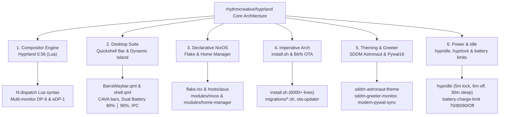

<h1 align="center">rhythm's hyprland-skill</h1>

<div align="center">
  <p><i>Developer guides, automation scripts, and workflow specifications for rhythmcreative/hyprland</i></p>
</div>

<div align="center">

[](https://archlinux.org/)
[](https://nixos.org/)
[](https://hyprland.org/)
[](https://github.com/outfoxxed/quickshell)
[](https://github.com/rhythmcreative/rust-dock)
[](https://github.com/hyprwm/hyprlock)
[](https://github.com/dylanaraps/pywal)
[](LICENSE)
[](https://ko-fi.com/rhythmcreative)

</div>

---

[](https://git.io/typing-svg)

### Quick install

Run directly in terminal with curl:

```bash
curl -fsSL https://raw.githubusercontent.com/rhythmcreative/hyprland-skill/main/install.sh | bash
```

### Manual install

Clone the repository and run the setup script:

```bash
git clone https://github.com/rhythmcreative/hyprland-skill.git ~/.local/share/hyprland-skill
~/.local/share/hyprland-skill/install.sh
```

---

[](https://git.io/typing-svg)

Structured following modular skill and runbook standards, this repository provides architecture documentation, runbooks, and automation tools for the [rhythmcreative/hyprland](https://github.com/rhythmcreative/hyprland) desktop ecosystem:



---

[](https://git.io/typing-svg)

Technical documentation is divided into modular reference guides located in `agents/skills/`:

<table>
  <tr>
    <th>Module Guide</th>
    <th>Domain Covered in rhythmcreative/hyprland</th>
  </tr>
  <tr>
    <td><a href="agents/skills/shell-dev.md"><b>shell-dev.md</b></a></td>
    <td><b>Quickshell Suite</b>: Declarative status bar (<code>BarraWaybar.qml</code>), Dynamic Island (<code>shell.qml</code>), tabs & subviews (1 to 7), IPC protocol, and multi-battery presentation (<code>80% │ 90%</code>).</td>
  </tr>
  <tr>
    <td><a href="agents/skills/hyprland-lua.md"><b>hyprland-lua.md</b></a></td>
    <td><b>Hyprland 0.56 (Lua)</b>: Native Lua configuration (<code>hl.config</code>), dispatchers (<code>hl.dispatch(hl.dsp....)</code>), multi-monitor geometry, and keybindings.</td>
  </tr>
  <tr>
    <td><a href="agents/skills/idle-and-power.md"><b>idle-and-power.md</b></a></td>
    <td><b>Idle & Power</b>: Safe timeout staging (5m lock, 6m screen off, 30m suspend), <code>hyprlock</code> flags, DPMS resume, and battery charge thresholds (<code>battery-charge-limit</code>).</td>
  </tr>
  <tr>
    <td><a href="agents/skills/nixos-and-flakes.md"><b>nixos-and-flakes.md</b></a></td>
    <td><b>NixOS & Home Manager</b>: Declarative flake architecture (<code>flake.nix</code>), system modules in <code>modules/nixos/</code>, user modules in <code>modules/home-manager/</code>, and derivations in <code>packages/</code>.</td>
  </tr>
  <tr>
    <td><a href="agents/skills/arch-installer-and-ota.md"><b>arch-installer-and-ota.md</b></a></td>
    <td><b>Arch Linux & OTA</b>: The 6,000-line <code>install.sh</code> pipeline, state migrations in <code>migrations/</code>, and atomic rollback updates (<code>ota-snapshot</code> & <code>ota-updater</code>).</td>
  </tr>
  <tr>
    <td><a href="agents/skills/sddm-and-theming.md"><b>sddm-and-theming.md</b></a></td>
    <td><b>SDDM & Theming</b>: Astronaut login theme on Wayland, <code>sddm-greeter-monitor</code> display detection, and <code>modern-pywal-sync</code> real-time palette distribution.</td>
  </tr>
  <tr>
    <td><a href="agents/skills/rust-dock.md"><b>rust-dock.md</b></a></td>
    <td><b>Rust Dock & Launchers</b>: Native GTK4/Layer-Shell dock written in Rust, pinned desktop entries, and singleton PID-locked Rofi menus.</td>
  </tr>
  <tr>
    <td><a href="agents/skills/git-workflow.md"><b>git-workflow.md</b></a></td>
    <td><b>Git Standards</b>: Strict <code>main</code> branch policy, imperative English commit messages, and repository-to-system synchronization rules.</td>
  </tr>
  <tr>
    <td><a href="agents/skills/visual-verification.md"><b>visual-verification.md</b></a></td>
    <td><b>Visual Quality Assurance</b>: Headless Wayland screenshot capture protocols with <code>grim -g</code> to inspect changes before declaring tasks complete.</td>
  </tr>
  <tr>
    <td><a href="agents/skills/system-scripts.md"><b>system-scripts.md</b></a></td>
    <td><b>Script Architecture</b>: Standards for utilities in <code>~/.local/bin/</code>, environment exports, and strict JSON output contracts.</td>
  </tr>
</table>

---

[](https://git.io/typing-svg)

This repository includes standalone helper scripts under `scripts/`:

```bash
# Check synchronization between ~/hyprland and ~/.config / ~/.local/bin
./scripts/sync-status

# Automatically synchronize modified repo files to the live system
./scripts/sync-status --sync

# Safely reload Hyprland, Quickshell, and Hypridle in live session
./scripts/reload-desktop

# Take a precise screenshot of the status bar for UI inspection
./scripts/capture-ui bar /tmp/bar.png

# Take a screenshot of the Dynamic Island
./scripts/capture-ui island /tmp/island.png

# Diagnose battery sensors, power supplies, and battery-info output
./scripts/test-battery
```

---

[](https://git.io/typing-svg)

> [!IMPORTANT]
> **1. Target Branch is strictly `main`**: Never commit to `dev`. All changes land directly in `main`.

> [!NOTE]
> **2. Commit Messages in English**: Write short, direct, imperative commit messages (e.g., `adjust multi-battery format and power supply icon in quickshell bar`). Avoid Conventional Commit prefixes like `feat:` or `fix:`.

> [!TIP]
> **3. Bidirectional Sync**: Files modified in `~/hyprland/` must be synchronized to their active home paths (`~/.config/` & `~/.local/bin/`) before testing or reloading.

> [!CAUTION]
> **4. Preserve Unicode Glyphs**: Never strip or corrupt multi-byte Nerd Font symbols (``, ``, ``, `▁▂▃▄▅▆▇█`). Ensure files remain UTF-8 encoded.

> [!WARNING]
> **5. Visual Verification**: Always inspect visual modifications using `./scripts/capture-ui` before marking work as done.

---

<div align="center">
  <p>Maintained by <b><a href="https://github.com/rhythmcreative">Rhythm Creative</a></b>.</p>
  <p>Licensed under the <a href="LICENSE">MIT License</a>.</p>
</div>
