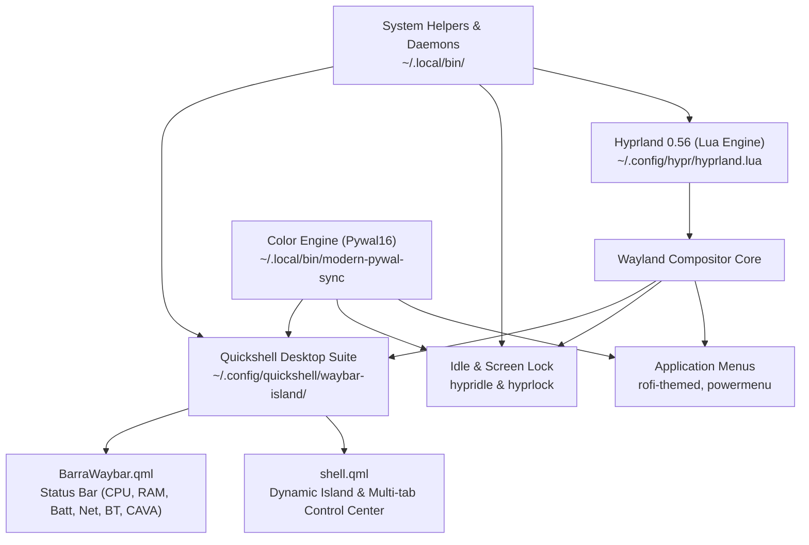

# Hyprland Desktop Ecosystem Skill (`hyprland-skill`)

This skill equips AI coding agents with deep domain expertise over the **rhythmcreative/hyprland** desktop environment—a modern, keyboard-centric Wayland setup based on **Hyprland 0.56 (Lua)** and a full **Quickshell** application suite (Waybar status bar replica and Dynamic Island control center).

Structured in the style of **Omarchy**, this repository provides modular procedures, architectural contracts, runnable developer scripts, and strict quality gates for rapid development.

---

## 🏛️ Core Architecture Overview

The desktop environment is divided into four distinct layers:



### Key Components

1. **Window Manager**: Hyprland 0.56 configured primarily via **Lua** (`hyprland.lua`). Dispatchers use Lua syntax: `hl.dispatch(hl.dsp....)`.
2. **Desktop Shell**: **Quickshell** running a single unified layer:
   - `BarraWaybar.qml`: Top status bar mimicking Waybar with native QML performance, dynamic CAVA visualizer, and multi-battery reporting.
   - `shell.qml`: Interactive Dynamic Island and multi-tab system control center (Audio, Brightness, Bluetooth, WiFi, Monitors, Batteries, Hyprland settings).
   - `IPC`: Inter-process communication via `quickshell ipc -p ~/.config/quickshell/waybar-island/shell.qml --any-display call island ...`.
3. **Power & Idle Management**:
   - `hypridle.conf`: 5 min screen lock (`pidof hyprlock || hyprlock`), 6 min display off (`screen-power off`), 30 min suspend (`systemctl suspend`).
   - `hyprlock.conf`: Blur background, live clock, quotes, battery & network status, `immediate_render = true`, `fade_on_empty = false`.
   - `screen-power`: Script executing Hyprland Lua DPMS commands to turn outputs on/off reliably.
4. **Helper Scripts**: Modular Python and Bash utilities located in `~/.local/bin/` (`battery-info`, `battery-charge-limit`, `notch-*-helper`, `rofi-themed`).

---

## 🛡️ The 5 Golden Rules for Agents

Agents working in this codebase **must** adhere strictly to the following five rules:

### 1. Git Branch is strictly `main`
- Never commit or push to `dev` unless explicitly instructed by the user.
- All stable work goes directly to `origin/main`.

### 2. Commit Messages in English (Natural & Concise)
- Commit messages must be written in **plain English**.
- Do **not** use Conventional Commits prefixes (avoid `feat:`, `fix:`, `refactor:`).
- Keep messages short, active, and specific.
- *Examples*:
  - ✅ `adjust multi-battery format and power supply icon in quickshell bar`
  - ✅ `fix hyprlock screen disappearance and idle sleep configuration`
  - ❌ `fix: arreglar las baterias`

### 3. Bidirectional Synchronization
The user maintains the git repository in `~/hyprland/`, but the live system runs from `~/.config/` and `~/.local/bin/`.
- Whenever you edit a file in `~/hyprland/`, you **must** copy it to its active system path:
  ```bash
  # Example: Quickshell
  cp ~/hyprland/.config/quickshell/waybar-island/BarraWaybar.qml ~/.config/quickshell/waybar-island/BarraWaybar.qml
  
  # Example: Hyprland & Lock
  cp ~/hyprland/.config/hypr/hypridle.conf ~/.config/hypr/hypridle.conf
  
  # Example: Binaries
  cp ~/hyprland/.local/bin/battery-info ~/.local/bin/battery-info
  ```
- Before committing, verify that both directories match.

### 4. Preservation of Unicode & Nerd Font Glyphs
- The UI relies heavily on Nerd Font v3 symbols (e.g., `󰂄` charging, `󰚥` AC plug, `󰁹` full battery, `󰔏` temp, `󰈀` ethernet).
- When editing QML or Bash files, **never** replace or corrupt multi-byte UTF-8 glyphs. Keep file encodings in strict UTF-8 (`LC_ALL=C.UTF-8`).

### 5. Visual Verification Before Declaring Done
- Do not assume UI changes look right; verify them using `grim` screenshots:
  ```bash
  WAYLAND_DISPLAY=wayland-1 XDG_RUNTIME_DIR=/run/user/1000 grim -g "0,0 2560x40" /tmp/test_bar.png
  ```
- Review the generated image to ensure alignments, colors, and margins match expectations.

---

## 📚 Modular Guides (`agents/skills/`)

For detailed procedures, consult the specialized topic guides:

| Guide | Description |
| :--- | :--- |
| [**shell-dev.md**](./agents/skills/shell-dev.md) | Developing & modifying Quickshell (`BarraWaybar.qml`, `shell.qml`), IPC, subviews, widgets. |
| [**hyprland-lua.md**](./agents/skills/hyprland-lua.md) | Hyprland 0.56 Lua syntax, dispatchers, keybindings, window rules, multi-monitor setups. |
| [**idle-and-power.md**](./agents/skills/idle-and-power.md) | Power supplies, single & dual battery logic, charging thresholds, `hypridle`, `hyprlock`. |
| [**visual-verification.md**](./agents/skills/visual-verification.md) | Screen capture protocols with `grim`, layer-shell inspection, troubleshooting black screens. |
| [**git-workflow.md**](./agents/skills/git-workflow.md) | Repository mapping, atomic commits in English, push verification, pull request workflows. |
| [**system-scripts.md**](./agents/skills/system-scripts.md) | Helper conventions in `~/.local/bin/`, argument parsing, JSON output contracts, environment safety. |
| [**nixos-and-flakes.md**](./agents/skills/nixos-and-flakes.md) | Declarative NixOS Flake (`flake.nix`), Home Manager modules, custom derivations in `packages/`. |
| [**arch-installer-and-ota.md**](./agents/skills/arch-installer-and-ota.md) | Arch setup script (`install.sh`), system migrations (`migrations/`), Btrfs atomic OTA updates. |
| [**sddm-and-theming.md**](./agents/skills/sddm-and-theming.md) | SDDM Astronaut theme, multi-monitor greeter setup, Pywal16 dynamic wallpaper color sync. |
| [**rust-dock.md**](./agents/skills/rust-dock.md) | Wayland native Rust dock (`packages/rust-dock/`) and Rofi dynamic application menus. |

---

## ⚡ Quick Developer CLI Tools (`scripts/`)

This skill includes standalone helper scripts located in `./scripts/`:

* [`scripts/sync-status`](./scripts/sync-status): Compare differences between `~/hyprland/` and live `~/.config`/`~/.local/bin`.
* [`scripts/reload-desktop`](./scripts/reload-desktop): Safely reload Quickshell, Hyprland, and Hypridle without dropping user windows.
* [`scripts/capture-ui`](./scripts/capture-ui): Capture screenshots of the top bar or Dynamic Island for quick verification.
* [`scripts/test-battery`](./scripts/test-battery): Inspect sysfs power supplies, detect dual batteries, and validate AC state.
