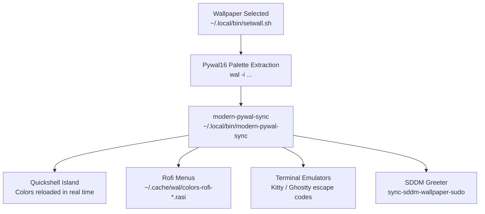

# SDDM Login Screen & Pywal Theming Guide (`sddm-and-theming.md`)

This guide covers the SDDM display manager integration, multi-monitor greeter setup, and the dynamic Pywal16 color synchronization pipeline.

---

## SDDM Astronaut Theme (`sddm/`)

The display manager uses a customized version of the **SDDM Astronaut Theme**:

* **QML UI**: `sddm/sddm-astronaut-theme/Main.qml` with custom background handling, avatar styling, and battery/power indicators.
* **Wayland Greeter**: Runs under Hyprland as a lightweight compositor greeter using `sddm/hyprland.lua` and `sddm/hyprland.conf`.
* **Greeter Monitor Adaptation (`sddm/sddm-greeter-monitor`)**:
  - Dynamically detects external displays (e.g. `DP-6`) vs internal laptop panels (`eDP-1`).
  - Ensures the login screen renders on the primary/external high-refresh monitor when docked.

---

## Pywal16 Dynamic Color Engine

When a wallpaper changes via `setwall.sh` or `wallpaper-selector`:

### Key Theming Daemons & Helpers
* **`modern-pywal-sync`**: Central script orchestrating color distribution across all desktop components.
* **`full-system-color-sync`**: Updates GTK 3/4 themes and Qt styling to match wallpaper tones.
* **`sync-sddm-wallpaper`**: Copies the active desktop wallpaper and color scheme into `/usr/share/sddm/themes/` so the login screen matches the locked desktop.
